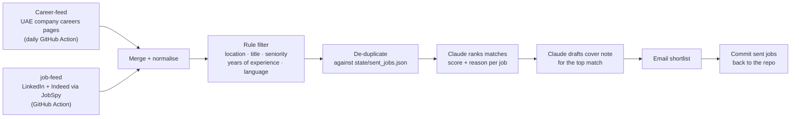

# job-agent

An AI job-search agent that runs every morning. It reads two job feeds I built, filters the listings against my criteria, uses Claude to rank the best matches and explain each one, drafts a cover note for the top match, and emails me the shortlist. It remembers what it has already sent, so no job arrives twice.



## The pieces

| Part | What it does |
|---|---|
| [Career-feed](https://github.com/georgeakshay/Career-feed) | Scans ~2,500 UAE company careers pages a day (Greenhouse, Lever, Workable, Workday and more, plus plain HTML) and publishes `career_jobs.json`. |
| [job-feed](https://github.com/georgeakshay/job-feed) | Pulls fresh LinkedIn and Indeed listings with the open-source [JobSpy](https://github.com/speedyapply/JobSpy) library. I moved to JobSpy from Apify after hitting usage limits. |
| `agent/feeds.py` | Downloads both feeds, maps them to one schema and merges them. A job reposted on several sites is kept once. |
| `agent/filters.py` | Cheap rule checks before any AI call: UAE or remote only, relevant titles, no Director/Head/VP roles, no jobs asking for 5+ years, no Arabic/German or nationals-only roles. |
| `agent/state.py` | Jobs are identified by title + company (and link), and every emailed job is saved in `state/sent_jobs.json`. |
| `agent/ranker.py` + `prompts/` | Claude scores each remaining job against [`profile.md`](profile.md), returns JSON with a reason and the experience asked, then writes a cover note for #1. Job text is treated as data, and any job id the model invents is ignored. |
| `agent/notify.py` | Builds a plain, scannable HTML email and sends it over SMTP. |
| `.github/workflows/agent.yml` | Runs the agent daily at 07:45 Dubai time, after both feeds refresh, and commits the updated sent-jobs file. |

Search criteria live in [`config.yaml`](config.yaml), so changing what the agent looks for needs no code change.

## Run it

```bash
pip install -r requirements.txt
python -m agent.main --dry-run   # feeds + rules + de-dup only; writes output/dry_run_candidates.json
python -m agent.main             # full run
```

A full run needs these environment variables (repo **Settings → Secrets → Actions** when run on GitHub):

| Secret | Purpose |
|---|---|
| `ANTHROPIC_API_KEY` | Claude API key |
| `SMTP_USER` / `SMTP_PASSWORD` | Sending mailbox and Gmail app password |
| `EMAIL_TO` | Where the shortlist goes |

Optional repo variable `CLAUDE_MODEL` overrides the default model. Without the secrets, the workflow falls back to a dry run.

## Design notes

- **Rules first, AI second.** Simple filters remove ~80% of listings, so Claude only reads plausible jobs. That keeps each run to a few cents.
- **One broken feed doesn't stop the run.** Each feed is loaded on its own and failures are logged.
- **Memory lives in git.** The sent-jobs file is committed after each run, so the history is visible and survives between runs.

Built by [Akshay George](https://georgeakshay.github.io), Business Analyst, Dubai.
